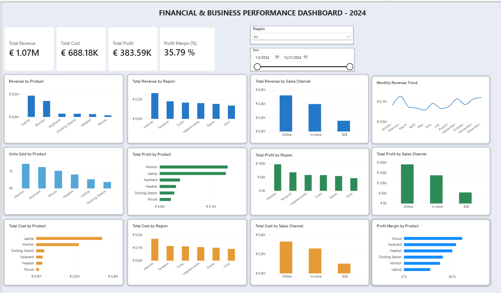

# Financial & Business Performance Analysis

**Power BI Dashboard Project**

An interactive Power BI dashboard designed to analyze financial and sales performance across products, regions, and sales channels.

This portfolio project demonstrates an end-to-end analytics workflow, including data preparation, transformation, DAX calculations, KPI development, and interactive dashboard design.

## Project Overview

The dashboard analyzes a sample dataset containing **500 transactions from 2024**. It provides insights into revenue, costs, profitability, and sales performance.

## Dashboard Preview



## Key Performance Indicators

| KPI | Result |
|---|---:|
| Total Revenue | €1.07M |
| Total Cost | €688.18K |
| Total Profit | €383.59K |
| Profit Margin | 35.79% |

## Key Areas of Analysis

- **Revenue Analysis:** Revenue by product, region, and sales channel.
- **Profitability Analysis:** Profit distribution across products, regions, and sales channels.
- **Cost Analysis:** Cost structure by product, region, and sales channel.
- **Sales Performance:** Units sold across product categories.
- **Monthly Trend Analysis:** Revenue trends throughout 2024.
- **Interactive Filtering:** Dynamic analysis using region and date slicers.

## Tools & Technologies

- Microsoft Power BI
- Power Query
- DAX (Data Analysis Expressions)
- Data Cleaning and Transformation
- Data Modeling
- Data Visualization
- KPI Development

## Key DAX Measures

**Total Revenue**
```dax
Total Revenue =
SUMX(
    SalesDataTable,
    SalesDataTable[Units_Sold] *
    SalesDataTable[Unit_Price_EUR]
)
```

**Total Cost**
```dax
Total Cost =
SUMX(
    SalesDataTable,
    SalesDataTable[Units_Sold] *
    SalesDataTable[Unit_Cost_EUR]
)
```

**Total Profit**
```dax
Total Profit =
[Total Revenue] - [Total Cost]
```

**Profit Margin (%)**
```dax
Profit Margin (%) =
DIVIDE([Total Profit], [Total Revenue], 0)
```

## Project Files

- `Financial & Business Performance Analysis- 01.pbix` – Power BI dashboard file.
- `Financial_Performance_Data.xlsx` – Sample dataset.
- `Financial_Performance_Dashboard.pdf` – PDF export of the dashboard.
- `Financial_Performance_Dashboard.png` – Dashboard preview image.

## Skills Demonstrated

- Data preparation and transformation
- Financial KPI calculations using DAX
- Business performance analysis
- Interactive dashboard development
- Data storytelling and visualization

## Notes

This is a portfolio project developed for practical learning and demonstration purposes. The dataset is sample data and does not represent actual company financial records.

---

Created as part of my Data Analytics Portfolio.
